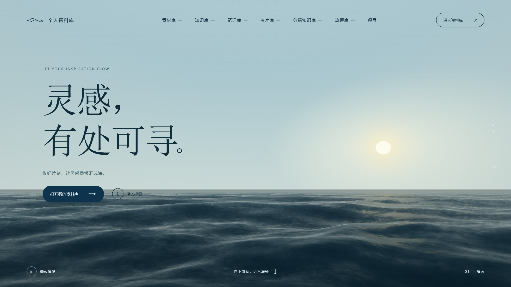
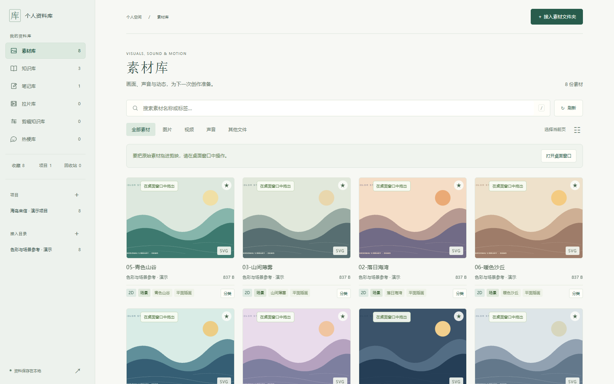
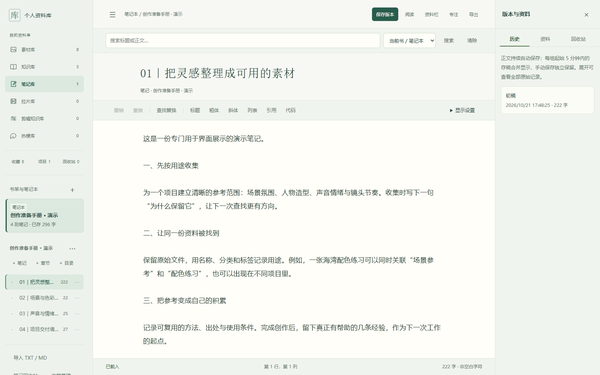

<h1 align="center">个人资料库｜AI 漫剧创作者素材归档工具</h1>

把素材、拉片、热梗与创作笔记收在一起，让下一次创作更容易找到所需资料。

<strong>Windows 10/11 x64 · 本地资料管理 · 无需安装 Python</strong>

  <a href="https://github.com/yuanyi0612-ops/personal-library/releases/download/v2026.10.21.2/personal-library-windows-x64-2026.10.21.2.zip"><strong>下载 Windows 工具包</strong></a>
  &nbsp; · &nbsp;
  <a href="使用说明.md">使用说明</a>
  &nbsp; · &nbsp;
  <a href="https://github.com/yuanyi0612-ops/personal-library/releases/latest">最新版本</a>

  

2026.10.21.2 版首页水上视图预览；下载包首次运行为空库。

## 围绕创作流程整理资料

个人资料库是一款面向 AI 漫剧创作者的本地归档与管理工具。接入已有素材文件夹，积累拉片与热梗资料，保存笔记和小说章节，再按分类、标签、搜索或项目关联找到它们。

| 创作时需要什么 | 在资料库中怎么整理 |
| --- | --- |
| 图片、视频、背景音乐等素材 | 接入本地文件夹，按分类、标签、收藏与搜索查找 |
| 原片、拉片报告与镜头参考 | 按作品组织拉片条目，保留原片与分析资料的关联 |
| 热梗、名场面与使用场景 | 整理台词、画面与声音提示，记录来源与用法 |
| 小说章节与创作笔记 | 管理作品目录、章节和笔记，回看历史存稿 |
| 知识笔记与剪辑方法 | 分别积累可复用的方法和经验 |
| 一个项目用到的多类资料 | 通过项目关联组织资料，减少重复查找 |

### 素材归档与检索

图片、视频与音频按用途整理；同一份素材可以用标签和项目关联服务多个创作任务。接入文件夹时，原文件仍保存在原位置。

使用独立演示资料拍摄，下载包首次运行为空库。

### 笔记与小说章节

把作品目录、章节和创作笔记放在同一个工作区中，编辑后留意保存状态，需要回看时查看历史存稿。

使用独立演示资料拍摄，下载包首次运行为空库。

## 三步开始使用

1. **下载并完整解压**：[获取 Windows 工具 ZIP](https://github.com/yuanyi0612-ops/personal-library/releases/download/v2026.10.21.2/personal-library-windows-x64-2026.10.21.2.zip)，解压到有写入权限的文件夹。
2. **双击启动**：打开根目录的 `PersonalLibrary.exe`，保留旁边完整的 `00-程序框架` 文件夹。
3. **放入自己的资料**：在页面接入已有素材文件夹，或新建作品、笔记与卡片。

首次运行会自动建立素材库、知识库、笔记小说库、拉片库、剪辑知识库、热梗库和项目这七个分类目录。**下载包不附示例资料，也不包含个人素材、章节、数据库或浏览器资料。**

## 使用前可以了解

<strong>常见问题：下载、资料位置与备份</strong>

**应该下载哪个文件？**

选择 `personal-library-windows-x64-2026.10.21.2.zip`。GitHub 自动生成的 “Source code” 压缩包对应本仓库的公开页面资料，并非程序源码或可运行工具。

**接入文件夹会复制原文件吗？**

接入会建立索引，原文件保留在原位置。移动、改名或换电脑后，需要重新核对外部素材路径。

**如何保存与备份？**

先确认编辑内容已保存，再关闭页面并使用 `停止本目录服务.cmd`。备份整个工具文件夹，同时保留外部引用的素材；`_系统数据` 包含数据库和运行资料，不能当作缓存清理。系统浏览器中尚未同步的草稿不包含在工具文件夹的备份里。详见 [使用说明](使用说明.md)。

<strong>运行环境：桌面窗口、浏览器与音频</strong>

- 适用于 **Windows 10/11 x64**，工具包自带 Python 运行环境。
- 优先打开桌面窗口；缺少 WebView2 Runtime 时会尝试打开系统默认浏览器，也可使用 `启动网页版.cmd`。桌面初始化失败时可点击窗口中的“在浏览器打开资料库”。
- 桌面与网页版共享已经保存到后台的资料，各自尚未同步的本地草稿不会自动互通；网页版不具备桌面壳的原生文件拖拽能力。
- 浏览器原生支持的音频可直接试听。**FFmpeg 是可选组件，不随包提供**；特殊格式需要兼容转码时，可按 [使用说明](使用说明.md) 配置。

<strong>版本验证与校验文件</strong>

基础版 2026.10.21 已通过 **208 项源码回归测试**。打包程序已在本机验证空库启动、素材索引、笔记与章节保存、重启读取、桌面首页加载及正常停止。

2026.10.21.2 在前一版天空取样修正的基础上，补上可见太阳、柔和光晕与对应的水面反光；仅更新首页渲染脚本和校验清单，其余 91 个文件与前一版一致。本修订通过脚本语法、WebGL 页面渲染和逐文件校验，未重复整套启动验收。尚未进行全新 Windows 电脑上的全部手工操作验收。版本详情见 [发布说明](发布说明.md)，工具包 SHA-256 见 [checksums.sha256](checksums.sha256)。

---

本仓库发布可使用的 Windows 工具及其说明，**开发源码保留在本地，不公开，也不作为 MIT 开源项目发布**。第三方组件保留各自的许可和声明，见 [第三方组件说明](第三方组件说明.md)。
